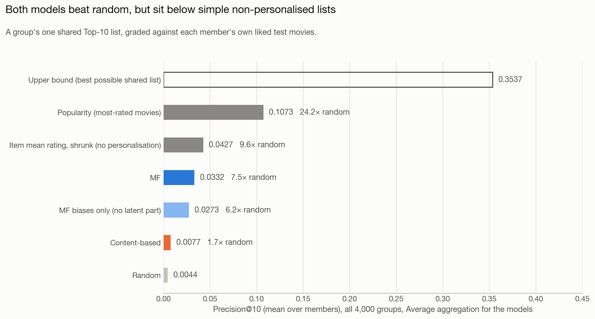
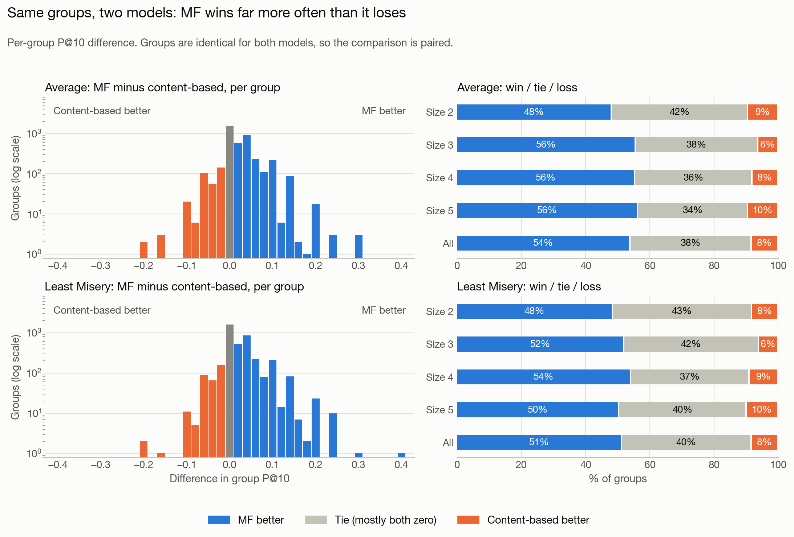
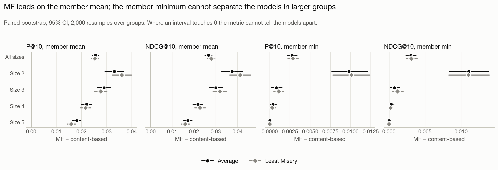
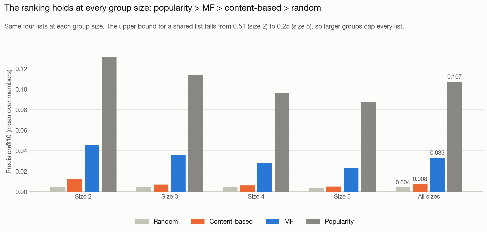
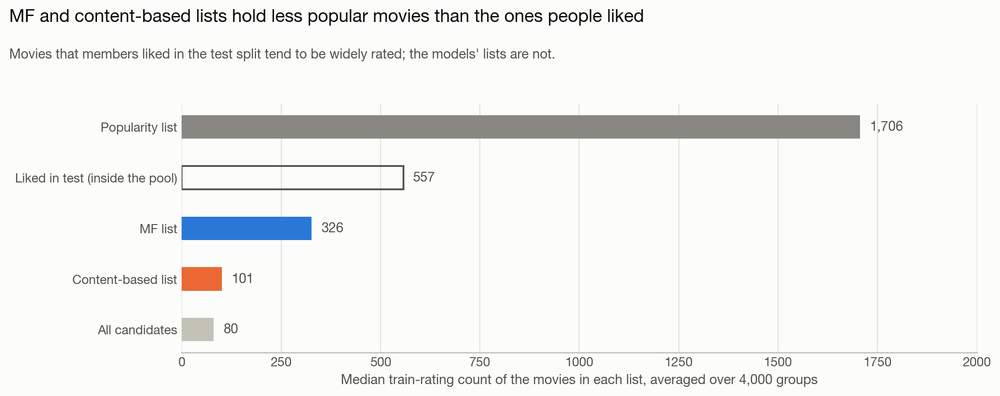
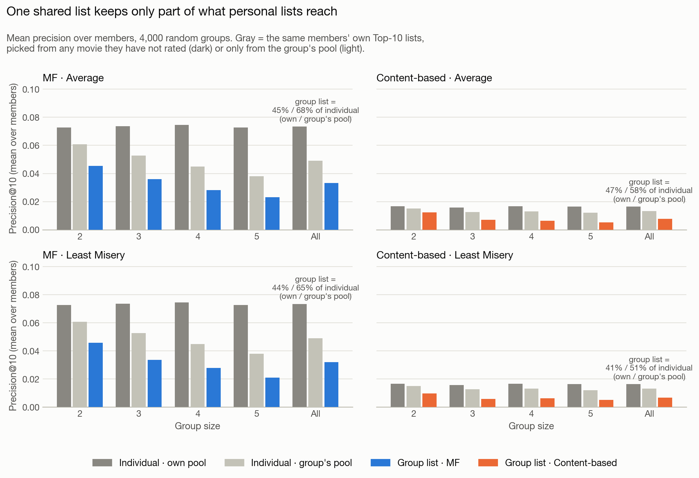
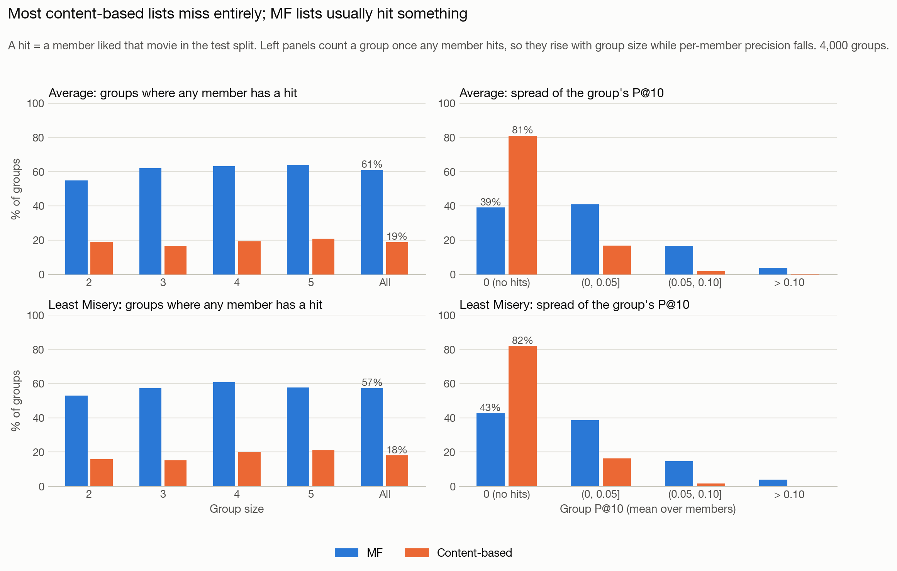
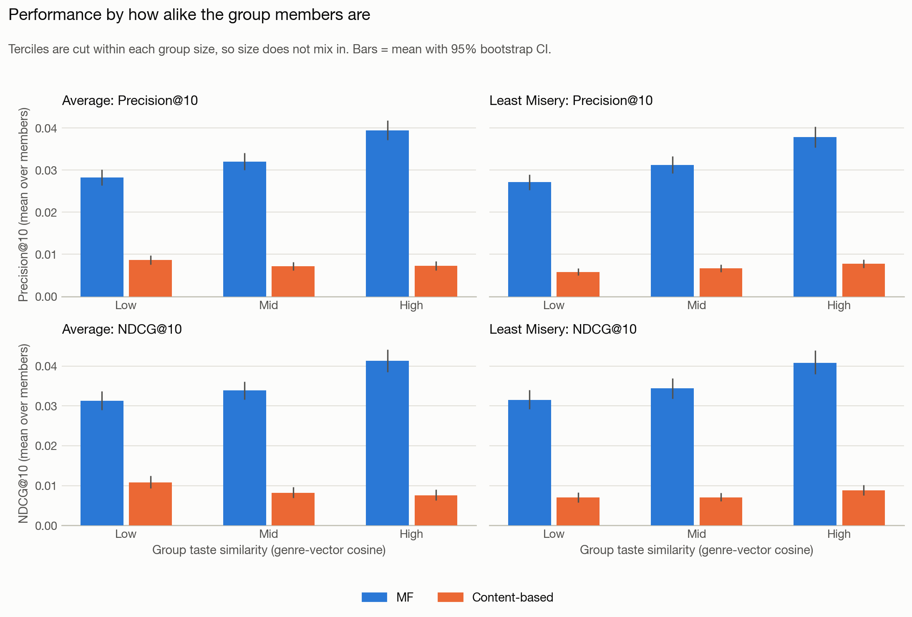
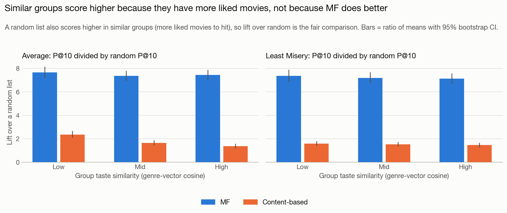
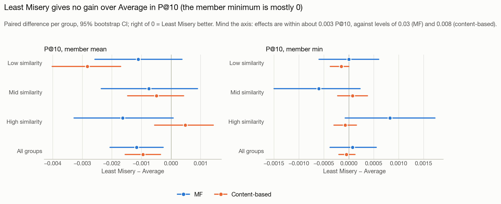

# 그룹 영화 추천 평가 보고서

팀원이 만든 두 추천 모델(Matrix Factorization, 콘텐츠 기반)을 **수정하지 않고** "그룹 추천"으로 평가한 결과입니다. 그림의 글자는 영어이고, 이 문서가 한국어 설명입니다. 문서 끝에 용어집이 있습니다.

## 0. 먼저 읽는 법 (작은 예)

세 사람이 영화 5편에 대해 모델이 예측한 점수가 아래와 같다고 합시다. 그룹은 **목록 하나**를 받고, 그 목록을 구성원 각자의 정답(테스트에서 좋아한 영화)으로 채점합니다. 목록 길이는 예시를 위해 2로 둡니다(실제 평가는 10).

| 영화 | A | B | C | Average (평균) | Least Misery (최솟값) |
|---|---|---|---|---|---|
| m1 | 5 | 4 | 2 | 3.67 | 2 |
| m2 | 4 | 4 | 4 | **4.00** | **4** |
| m3 | 5 | 5 | 1 | 3.67 | 1 |
| m4 | 3 | 4 | 4 | 3.67 | **3** |
| m5 | 2 | 3 | 5 | 3.33 | 2 |

- **그룹 목록을 만드는 규칙:** Average는 점수 평균이 높은 순, Least Misery는 가장 낮은 점수가 높은 순입니다. Average 목록은 [m2, m1](m1·m3·m4가 같은 점수라 번호가 작은 m1), Least Misery 목록은 [m2, m4]입니다.
- **정답:** A는 {m1, m2}, B는 {m4}, C는 {m2, m4}를 좋아했습니다.
- **채점(P@2 = 목록 중 좋아한 영화의 비율):** Average 목록은 A 1.0, B 0, C 0.5, Least Misery 목록은 A 0.5, B 0.5, C 1.0입니다.
- **결과를 요약하는 규칙:** 구성원 평균(만족도)은 Average 0.50, Least Misery 0.67이고, 구성원 최솟값(공정성)은 Average 0, Least Misery 0.5입니다.

두 가지 "평균/최솟값"이 서로 다른 단계에 쓰이니 구분하세요. 앞의 Average/Least Misery는 **추천을 만드는 방식**이고, 구성원 평균/최솟값은 **결과를 재는 방식**입니다.

## 1. 결론부터

| 질문 | 답 |
|---|---|
| 어느 모델이 더 나은가? | **이 평가에서는 MF가 콘텐츠 기반보다 앞섭니다(Average 기준).** 그룹 평균 P@10이 0.0332 대 0.0077(약 4.3배)이고, 같은 그룹끼리 비교하면 MF가 이긴 그룹 54%, 동률 38%(대부분 둘 다 0), 진 그룹 8%입니다. 후보를 많이 평가된 영화로 제한해도 MF가 앞섭니다(MF/콘텐츠 배율은 평가 50·100개 이상 영화만 후보로 하면 4.3·4.2배로 거의 같고 200개 이상에서 2.6배로 줄지만, 절대 차이는 0.0255에서 0.0360으로 오히려 커집니다). 콘텐츠 기반은 영화의 72%에서 장르 정보만 쓰는 입력의 한계도 섞여 있어, 이 격차를 "방법 자체의 우열"로 읽으면 안 됩니다. |
| 점수가 좋은 편인가? | **아니요, 절대 성능은 낮습니다.** 무작위보다는 확실히 높지만(Average 기준 MF 7.5배, 콘텐츠 기반 1.7배), 영화 평점 개수만 세는 인기도순 추천(0.1073)보다 낮습니다. |
| 왜 낮은가? | (A) 전반적으로 낮은 이유는 정답이 적고 후보가 많은 평가 구조와 그룹이 목록 하나를 공유하는 제약입니다(인기도순도 상한의 30%). (B) 인기도순보다도 낮은 이유는 별개입니다. MF 목록은 서로 다른 그룹에서도 거의 같은 영화(4,000개 그룹에서 258편)로 채워지고, 영화 편향 같은 비개인화 성분에 크게 의존합니다(편향 항만으로 MF의 82%, 3.4절, 4장). |
| 그런데도 의미가 있는 이유는? | 이 프로젝트의 질문은 "두 모델을 같은 조건에서 비교하고 그룹 집계 방식을 비교하는 것"입니다. 같은 그룹, 같은 후보 풀, 같은 정답으로 비교했고 그룹을 다시 뽑아도(seed 4개) 결과가 비슷합니다(3.8절). |
| 집계 방식(Average, Least Misery)은? | **Least Misery가 Average보다 나은 점은 없었습니다.** 그룹 4,000개의 짝 비교에서 P@10은 Average가 약간 높습니다(MF 0.0332 대 0.0321, 콘텐츠 기반 0.0077 대 0.0067; 차이의 95% 구간이 두 모델 모두 0 아래). 두 방식의 목록은 상당히 다른데도(10편 중 MF 6.5편, 콘텐츠 기반 3.0편만 겹침) 점수는 비슷합니다. 다만 구성원 최솟값 지표는 거의 항상 0이라 Least Misery의 목적인 "공정성"은 이 지표로 측정할 수 없습니다. |
| 주장해도 되는 것은? | 6장에 있습니다. |



## 2. 무엇을, 어떻게 평가했나

### 2.1 목적과 모델

- 프로젝트 목표는 2~5명 사용자의 취향을 함께 고려하는 그룹 영화 추천입니다(README).
- 모델 두 개는 개인 단위로 만들어졌고 그룹 기능이 없습니다. 이번 평가는 두 모델의 **개인별 점수를 그룹 점수로 합치는 방식**으로 그룹 추천을 만들었습니다.
  - **MF:** `mf_scores.csv`(사용자×영화 예상 평점). 평점 예측 정확도(RMSE)를 줄이도록 학습한 모델입니다. 테스트 RMSE 0.8553은 전체 평균 기준선 1.1178(README)보다 23.5% 낮습니다.
  - **콘텐츠 기반:** 장르·키워드·줄거리를 TF-IDF로 만든 영화 벡터와 사용자 취향 벡터의 코사인 유사도.
- 두 모델 파일(`mf.py`, `content_based.py`, `run_mf.py`)은 한 줄도 수정하지 않았습니다.

### 2.2 데이터와 평가 절차

**데이터.** MovieLens 1M(사용자 6,040명). 사용자별로 평점의 20%를 **무작위로** 테스트로 뗐고(시간순 분할이 아님) 모델은 나머지 80%(800,193건)만 봅니다. 모든 사용자가 학습 평점을 16개 이상 가진 사용자(콜드 스타트 없음)입니다. 정답은 테스트에서 4점 이상 준 영화입니다. 이 방식에서는 사용자가 실제로 평가한 영화만 정답이 될 수 있어서 **많이 평가된 영화가 유리합니다**(4장 5항).

```
① 학습 사용자 6,040명에서 2·3·4·5명을 무작위로 뽑아 가상 그룹 4,000개 생성 (크기별 1,000개, seed 42)
② 후보 영화 = 학습에 나온 3,680편 중 "그룹 구성원 누구도 학습에서 평가하지 않은 영화"
③ 각 모델이 구성원 한 명 한 명의 점수를 계산 → Average 또는 Least Misery로 그룹 점수를 만듦 (추천을 만드는 방식)
④ 그룹 점수가 높은 10편 = 그룹의 Top-10 목록 (그룹당 목록 하나)
⑤ 각 구성원이 테스트에서 4점 이상 준 영화로 채점 → 구성원별 P@10을 평균(만족도)과 최솟값(공정성)으로 요약 (결과를 재는 방식)
```

### 2.3 지표

- **P@10 (Precision@10):** Top-10 중 구성원이 좋아한(테스트에서 4점 이상 준) 영화의 비율. 0~1.
- **NDCG@10:** 정답이 목록 앞쪽에 있을수록 점수가 높은 지표. 0~1.
- **실제 예 (사례 2, 그룹 90, 두 명):** MF 목록에서 A가 3·4·6·8위의 4편, B가 4·9위의 2편을 좋아했습니다. A의 P@10은 0.4, B는 0.2이고, 구성원 평균 P@10은 0.3, 구성원 최솟값은 0.2입니다.

### 2.4 설계에서 고른 것과 이유

| 선택 | 이유 |
|---|---|
| 구성원별 개별 채점(그룹 목록 하나를 구성원 각자의 정답으로 채점) | 무작위 그룹에서는 구성원 전원이 테스트에서 함께 평가한 영화가 거의 없습니다. 전원이 평가한 영화가 1편 이상인 그룹은 2명 41.6%, 3명 3.7%, 4명 0.2%, 5명 0%였습니다(크기별 무작위 3,000그룹, seed 0 측정; 평가에 쓴 4,000그룹에서는 38.5/3.8/0.5/0.0%). 그래서 "그룹 공통 정답"을 만들 수 없습니다. 대안(전원이 평가한 영화로 2명 그룹만 평가, 일부 구성원만 좋아한 영화에 가중치 등)은 하지 않았습니다. |
| 정답 = 테스트에서 4점 이상 | 테스트 평점의 57.3%가 정답입니다. 다른 기준(5점만, 3점 이상)이나 K 값은 시험하지 않았습니다. |
| 후보 풀을 두 모델이 같게 사용 | MF는 학습에 나온 3,680편만 점수가 있습니다. 같은 풀이어야 비교가 공정합니다. |
| 구성원 누구든 본 영화는 제외 | "이미 본 영화를 추천하지 않는다"는 README 규칙을 그룹으로 확장했습니다. 이는 설계 선택이고, 구성원 정답의 12~38%가 후보에서 빠지는 비용이 있습니다(3.5절). |
| 정답 0편인 구성원은 채점에서 제외 | 63명(0.45%). 어떤 추천이든 점수가 0이라 구성원 최솟값이 0으로 고정되기 때문입니다. 이 구성원의 점수는 그룹 점수에는 그대로 반영되고, 두 모델에 똑같이 적용됩니다. |
| 동점은 두 방식으로 모두 보고 | 콘텐츠 기반은 Top-10 경계가 동점인 그룹이 90%(Average; MF는 0.4%)입니다. movieId 오름차순(팀원 코드 규칙)과 무작위 5회 평균을 비교했더니 전체 평균은 거의 같았습니다(0.0077 대 0.0080). |
| 그룹 4,000개 | 같은 그룹을 두 모델에 적용해 짝 비교합니다. 구성원 14,000자리를 5,446명이 채우고 사용자의 75.2%가 둘 이상의 그룹에 들어가므로(최대 10개 그룹) 그룹이 완전히 독립이 아니고, 그룹 단위 신뢰구간은 다소 좁게 나올 수 있습니다. 대신 다른 seed 3개로 그룹을 다시 뽑아 결과가 안정적인지 확인했습니다(3.8절). |

## 3. 결과

### 3.1 모델 비교 (전체 4,000그룹)

| 모델 | 집계 | P@10 평균 | NDCG@10 평균 | P@10 최솟값 | NDCG@10 최솟값 |
|---|---|---|---|---|---|
| MF | Average | **0.0332** | **0.0355** | 0.0030 | 0.0033 |
| MF | Least Misery | 0.0321 | 0.0355 | 0.0031 | 0.0034 |
| 콘텐츠 기반 | Average | 0.0077 | 0.0089 | 0.0002 | 0.0003 |
| 콘텐츠 기반 | Least Misery | 0.0067 | 0.0076 | 0.0002 | 0.0003 |

최솟값 열은 거의 0이라 "공정하다/불공정하다"를 읽을 수 있는 값이 아닙니다(3.7절).

### 3.2 같은 그룹끼리 짝지어 비교



| 집계 | MF가 나음 | 동률(대부분 둘 다 0) | 콘텐츠 기반이 나음 |
|---|---|---|---|
| Average | 54% | 38% | 8% |
| Least Misery | 51% | 40% | 8% |



- 구성원 평균 지표의 MF−콘텐츠 차이는 전체와 모든 크기에서 95% 신뢰구간이 0과 떨어져 있습니다. 전체 P@10 차이는 Average +0.0255(구간 0.0242~0.0268), Least Misery +0.0253이고, NDCG@10 차이는 +0.0266, +0.0279입니다.
- 구성원 최솟값 지표는 그룹이 커질수록 차이가 사라집니다. 5명 그룹에서는 두 모델 모두 모든 그룹에서 값이 정확히 0입니다(바닥 효과이고 모델의 성질이 아닙니다).

### 3.3 기준점과 비교

| 목록 | P@10 | NDCG@10 | 설명 |
|---|---|---|---|
| 이론적 상한 | 0.3537 | - | 그룹이 목록 하나를 공유할 때 낼 수 있는 최대값(정답을 알고 고른 경우). 2명 0.51에서 5명 0.25 |
| **인기도순** | **0.1073** | 0.1282 | 학습 평점 개수가 많은 영화 순. 개인화 없음 |
| 영화 평균 평점(수축) | 0.0427 | 0.0505 | 영화별 평균 평점을 가짜 평점 10개로 수축해 정렬한 한 가지 목록. 개인화 없음 |
| MF (Average) | 0.0332 | 0.0355 | 인기도의 31% |
| MF에서 잠재요인을 뺀 것 | 0.0273 | 0.0246 | 영화 편향(b_i)만 남은 목록. 사용자와 그룹에 상관없이 거의 같음 |
| 콘텐츠 기반 (Average) | 0.0077 | 0.0089 | 인기도의 7% |
| 무작위 | 0.0044 | 0.0047 | 정확한 기댓값 |

- 인기도순이 MF보다 높은 그룹은 80.0%, 낮은 그룹은 5.6%입니다(동률 14.4%). 콘텐츠 기반과는 88.3% 대 1.5%입니다. MF에서 인기도를 뺀 평균 차이는 −0.0741(95% 구간 −0.0765~−0.0719)입니다.
- 콘텐츠 기반은 모든 그룹 크기에서 무작위보다 높습니다(차이의 95% 구간이 0과 떨어져 있음). 다만 5명 그룹에서는 +0.0011로 아주 작습니다.
- **개인 추천에서도 같은 순서입니다.** 같은 구성원에게 각자 자기 점수로 만든 Top-10의 P@10은 MF 0.0734, 콘텐츠 기반 0.0163, 인기도순 0.1457이고, 개인 추천의 이론적 상한은 0.7921입니다. 점수가 낮은 것은 그룹이라서만이 아닙니다.



### 3.4 왜 인기도순보다 낮은가: MF와 콘텐츠 기반 목록의 성격



**추천된 영화의 인기도.** 영화별 학습 평점 개수의 중앙값(그룹별 중앙값의 평균)은 인기도순 목록 1,706, 구성원이 테스트에서 좋아한 영화(후보 풀 안) 557, MF 목록 326, 콘텐츠 기반 목록 101, 후보 전체 80입니다. 사용자가 좋게 평가한 영화는 많이 평가된 영화에 몰려 있는데(많이 본 영화일수록 평점이 남을 가능성이 높고, 이 평가는 그 노출 편향을 그대로 정답으로 삼습니다), MF 목록은 중간 정도, 콘텐츠 기반 목록은 후보 중앙값(80)에 가까운 영화를 추천합니다.

**MF 목록은 서로 다른 그룹에서도 거의 같습니다.** 4,000개 그룹의 MF(Average) Top-10에 등장한 영화는 서로 다른 258편뿐입니다(콘텐츠 기반은 882편, 인기도순은 201편). Sanjuro(1962)가 그룹의 94.5%에 들어 있고, 무작위 두 그룹의 MF 목록은 10편 중 평균 4.5편이 겹칩니다. 사례 그림(fig7)의 세 목록에도 같은 영화가 반복됩니다.

**MF 점수는 무엇에 기대는가.** MF를 같은 설정으로 다시 학습해서(테스트 RMSE 0.8553, `mf_final.csv`와 소수점 10자리까지 일치, 점수 파일과의 차이는 최대 5e-05) 점수를 나눠 봤습니다.

- 잠재요인(p·q)을 빼고 μ+b_u+b_i만 쓰면 P@10이 0.0273으로 MF(0.0332)의 82%입니다. 사용자 편향 b_u는 영화 순위를 바꾸지 않으므로 이 목록은 사용자와 그룹에 거의 상관없이 한 가지(4,000개 그룹에서 서로 다른 영화 43편)이고, Apple, The (Sib)(1998)가 그룹의 99.7%에 들어 있습니다.
- 잠재요인만 쓰면 P@10이 0.0211(무작위의 4.8배)이고 서로 다른 영화 2,073편이 등장합니다. 개인화 신호는 있지만 약합니다.
- 개인화 없이 영화별 평균 평점을 수축해(가짜 평점 10개를 섞어) 정렬한 한 가지 목록은 0.0427로 MF보다 높습니다(튜닝 없는 한 가지 설정이고 테스트 데이터로 평가했습니다).
- 평점 예측 오차도 편향이 대부분을 설명합니다. 테스트 RMSE는 전체 평균 1.1178, 편향 모델(k=0) 0.9105, MF 0.8553이고, 전체 평균 대비 개선의 79%가 편향에서 옵니다.

**인기도를 맞춘 비교.** 인기 있는 영화를 추천하는 쪽이 이 평가에서 유리하므로, 후보를 학습 평점 N개 이상의 영화로 제한해 두 모델을 다시 비교했습니다(Average, 4,000그룹).

| 후보 제한 | 그룹당 후보 | 무작위 | MF | 콘텐츠 기반 | MF/콘텐츠 | 인기도순 |
|---|---|---|---|---|---|---|
| 없음 | 3,280 | 0.0044 | 0.0332 (7.5배) | 0.0077 (1.7배) | 4.3배 | 0.1073 |
| 50개 이상 | 1,968 | 0.0074 | 0.0485 (6.6배) | 0.0112 (1.5배) | 4.3배 | 0.1073 |
| 100개 이상 | 1,480 | 0.0096 | 0.0550 (5.7배) | 0.0132 (1.4배) | 4.2배 | 0.1073 |
| 200개 이상 | 898 | 0.0144 | 0.0583 (4.0배) | 0.0223 (1.5배) | 2.6배 | 0.1073 |

(괄호는 무작위 대비 배율입니다.) 후보를 인기 영화로 좁혀도 MF가 콘텐츠 기반보다 앞서므로 MF의 우위가 "인기 영화를 추천해서"만은 아닙니다. 하지만 MF의 무작위 대비 배율은 7.5배에서 4.0배로 줄어서, MF가 맞힌 것의 일부는 인기 영화를 고른 효과일 수 있습니다. MF/콘텐츠 배율은 평가 50·100개 이상으로 제한해도 4.3·4.2배로 거의 같고 200개 이상에서야 2.6배로 줄며, 절대 차이는 0.0255에서 0.0373, 0.0418, 0.0360으로 오히려 커집니다. 후보를 좁혀도 인기도순(0.1073)에는 미치지 못합니다.

**콘텐츠 기반의 입력 한계.** 영화 3,680편 중 TMDB 줄거리 또는 키워드가 있는 영화는 27.8%(1,024편)뿐이고, 나머지 72.2%(2,656편)는 장르 정보만으로 점수가 매겨집니다. 그래서 같은 점수의 영화가 많이 생깁니다. TMDB 정보가 있는 영화만으로 비교해서 "방법"과 "데이터"의 영향을 가르는 분석은 하지 않았습니다.

### 3.5 그룹으로 합치면 무엇을 잃는가



개인 추천(각 구성원에게 자기 점수로 만든 Top-10)과 그룹 목록을 비교했습니다. 개인 추천은 본인이 안 본 영화 전체가 후보이고(own pool), 그룹 목록은 구성원 누구도 안 본 영화만 후보라서(group's pool) **후보 풀이 다릅니다.** 그래서 풀을 같게 맞춘 개인 추천도 계산해 두 값을 모두 적었습니다(Average 기준, P@10).

| 모델 | 개인 추천 (본인만 제외) | 개인 추천 (그룹과 같은 풀) | 그룹 목록 | 유지 비율 (own / group's pool) |
|---|---|---|---|---|
| MF | 0.0734 | 0.0491 | 0.0332 | 45% / **68%** |
| 콘텐츠 기반 | 0.0163 | 0.0132 | 0.0077 | 47% / **58%** |

- Least Misery에서는 유지 비율이 MF 44% / 65%, 콘텐츠 기반 41% / 51%입니다.
- 그룹이 커질수록 줄어듭니다. 같은 풀 기준(Average)으로 MF는 2명 75%에서 5명 61%로, 콘텐츠 기반은 83%에서 42%로 내려갑니다.
- 두 기준의 차이는 설계에서 오는 손실입니다. 구성원이 테스트에서 좋아한 영화 중 다른 구성원이 학습에서 이미 본 영화의 비율이 2명 12.0%, 3명 22.7%, 4명 31.1%, 5명 37.8%(전체 29.1%)이고, 이 영화들은 어떤 그룹 목록에도 들어갈 수 없습니다.
- 이 수치는 "그룹 목록 대 개인 목록"의 비교이고, Average와 Least Misery 중 어느 쪽이 나은지에 대한 답이 아닙니다.

### 3.6 분포: 평균이 가리는 것



- 그룹 점수(구성원 평균 P@10)가 0인 그룹이 콘텐츠 기반은 81%(Average), MF는 39%입니다. 구성원 중 누군가 한 편이라도 맞힌 그룹은 MF 61%, 콘텐츠 기반 19%입니다(Least Misery: 57%, 18%).
- 콘텐츠 기반의 평균 0.0077은 소수 그룹이 끌어올린 값이고 대부분의 그룹은 완전히 빗나갑니다.
- 왼쪽 그림의 "한 편이라도 맞힌 그룹"은 구성원이 많을수록 기회가 늘어 올라갑니다(MF Average 2명 55%에서 5명 64%). 구성원 평균 P@10은 반대로 내려가니 두 그림을 혼동하지 마세요.

### 3.7 구성원이 비슷할수록 잘 맞는가, 그리고 Least Misery는 도움이 되는가



구성원 쌍마다 "4점 이상 준 학습 영화의 장르 분포" 코사인 유사도를 구해 그룹 평균을 냈고, 같은 크기 안에서 낮음/중간/높음 삼분위로 나눴습니다(평균 유사도 낮음 0.57, 중간 0.73, 높음 0.85; 낮음 구간은 0.08~0.69). 그룹 1개는 구성원 한 명의 장르 벡터가 비어 있어 유사도를 계산할 수 없어 뺐습니다(3,999그룹 사용). 장르 벡터가 빈 구성원이 있는 다른 5개 그룹은 나머지 구성원 쌍으로 계산했습니다.

- MF의 P@10(Average)은 낮음 0.0283, 중간 0.0320, 높음 0.0395로 비슷한 그룹에서 약 40% 높습니다.
- **그러나 이것은 "쉬운 그룹" 효과입니다.** 비슷한 그룹은 정답(좋아한 영화)이 더 많아서 무작위 목록도 같이 올라갑니다(무작위 P@10 0.0037, 0.0043, 0.0053, +44%).



- 무작위 대비 배율로 보면 MF는 7.7배, 7.4배, 7.4배로 **차이가 없습니다.** 인기도순도 0.0915, 0.1073, 0.1232(+35%)로 같이 오릅니다. 따라서 "비슷한 그룹에서 MF가 더 잘한다"는 근거는 없습니다.
- 콘텐츠 기반은 무작위 대비 배율이 2.4배, 1.6배, 1.4배(Average)로 오히려 낮아집니다. Least Misery에서는 1.6배, 1.5배, 1.5배입니다.



- **Least Misery가 Average보다 낫다는 증거는 없고, P@10은 오히려 약간 낮습니다.** 그룹 4,000개를 합친 짝 비교에서 Least Misery−Average는 MF −0.0012(95% 구간 −0.0021~−0.0003, 상대 −3.5%), 콘텐츠 기반 −0.0010(−0.0016~−0.0004, 상대 −12%)이고, NDCG@10은 MF에서는 차이가 없고(+0.0001) 콘텐츠 기반에서는 −0.0012(−0.0020~−0.0005)입니다. 3.8절의 seed 4개에서도 두 모델 모두 Least Misery가 매번 낮았습니다(`group_eval_diag_seeds.csv`). 삼분위로 쪼개면(그룹 약 1,330개씩) 구간이 넓어져서, 12개 비교 중 확실히 0과 분리된 것은 하나(콘텐츠 기반·유사도 낮음, −0.0028)이고 0 경계에 걸친 구간이 둘 더 있습니다(MF·유사도 높음 −0.0033~+0.0001, 콘텐츠 기반·유사도 낮음의 최솟값 지표 −0.0004~0.0000). 모두 Least Misery가 같거나 더 나쁜 쪽입니다. 효과 크기는 최대 0.003 안팎입니다.
- **이 결과의 힘에 한계가 있습니다.** (1) 유사도 "낮음" 구간은 무작위 그룹의 하위 1/3이지 "취향이 정반대"인 그룹이 아닙니다. (2) 구성원 최솟값 P@10은 거의 항상 0이라(5명 그룹은 전부 0) Least Misery의 목적인 "가장 불만족한 구성원 보호"를 이 지표로는 잴 수 없습니다. "차이가 없다"가 아니라 "이 지표로는 구분되지 않는다"입니다. (3) Average와 Least Misery 목록은 서로 상당히 다르므로(겹침 MF 6.5/10, 콘텐츠 기반 3.0/10) 목록이 같아서 차이가 없는 것은 아닙니다. (4) MF의 Least Misery가 가장 박하게 점수를 주는 구성원의 편향(b_u)을 따라갈 가능성은 검증하지 않았습니다.

### 3.8 결과는 안정적인가: seed 반복

그룹을 다른 seed(1, 2, 3)로 다시 뽑아(각 4,000그룹) 같은 평가를 반복했습니다. 표의 값은 P@10 평균(seed별 값의 평균 ± 표본표준편차, n=4)입니다.

| 목록 | seed 42, 1, 2, 3의 평균 ± 표준편차 |
|---|---|
| MF (Average) | 0.0338 ± 0.0007 |
| MF (Least Misery) | 0.0322 ± 0.0006 |
| 콘텐츠 기반 (Average) | 0.0075 ± 0.0002 |
| 콘텐츠 기반 (Least Misery) | 0.0067 ± 0.0002 |
| 인기도순 | 0.1077 ± 0.0011 |
| 무작위 | 0.0045 ± 0.0001 |

seed가 달라도 순서와 크기는 비슷합니다. Least Misery는 두 모델 모두 매 seed에서 Average보다 낮았습니다. (같은 사용자가 여러 그룹에 들어가는 영향은 사용자 단위 부트스트랩으로는 확인하지 않았습니다.)

### 3.9 실제 그룹 세 개

선정 규칙은 아래 표의 규칙이고 `eval_group_report.py`의 `pick_cases`로 재현됩니다(Average 집계 기준, 동점이면 group_id가 가장 작은 그룹).

| 사례 | 규칙 | 그룹 | 구성원별 P@10 |
|---|---|---|---|
| 1. 평균에 가까운 그룹 | (MF, 콘텐츠) P@10 쌍이 전체 평균에 가장 가까운 그룹 | 1004 (3명) | MF 0.0·0.0·0.1, 콘텐츠 0·0·0 |
| 2. MF가 가장 크게 이긴 그룹 | MF가 가장 크게 이긴 그룹 | 90 (2명) | MF 0.4·0.2, 콘텐츠 0·0 |
| 3. 콘텐츠 기반이 가장 크게 이긴 그룹 | 콘텐츠 기반이 가장 크게 이긴 그룹 | 406 (2명) | MF 0·0, 콘텐츠 0·0.4 |

- 그림: `figures/fig7_case1_near_average_group.png`, `fig7_case2_largest_mf_win.png`, `fig7_case3_largest_content_based_win.png`
- 사례 2와 3은 정의상 극단값이라 대표적인 모습이 아닙니다. 사례 1은 (MF 0.033, 콘텐츠 0)인 그룹 259개 중 group_id가 가장 작은 그룹이고 "콘텐츠 기반이 한 편도 못 맞히는 흔한 상황"을 보여줍니다. 사례 2는 동률인 그룹 90·263·765 중, 사례 3은 그룹 406·845 중 골랐습니다.
- 세 사례의 MF 목록에는 같은 영화(Wrong Trousers와 Sanjuro는 세 목록 모두)가 반복됩니다. 3.4절의 현상의 일부입니다.
- 사례 2에서 콘텐츠 기반 목록 10편이 전부 1994~1996년 영화였습니다. 이 그룹은 Top-10 전체가 같은 점수의 영화(장르 정보만 있는 영화)라 movieId 순으로 깨진 결과입니다(전체 평균은 동점 처리 방식에 둔감하지만, 이 그룹의 콘텐츠 기반 P@10은 movieId 순에서 0.00이고 무작위 동점 해소에서는 기댓값이 약 0.02입니다(5회 평균 0.03)).

## 4. 점수가 낮은 이유 (정리)

### 4-A. 점수가 전반적으로 낮은 이유 (인기도순과 모델 모두에 해당)

1. **정답은 적고 후보는 많습니다.** 그룹당 후보는 평균 3,280편(최소 1,531, 최대 3,647)인데 사용자당 정답은 평균 19.0편(중앙값 12편)입니다. 무작위로 고르면 P@10이 0.44%입니다. 사용자의 42.8%는 정답이 10편 미만이라 목록 10편으로 만점(1.0)이 불가능하고, 개인 추천의 상한도 0.79입니다.
2. **평점이 없는 영화는 오답으로 셉니다.** MovieLens에는 사용자가 본 영화의 평점만 있어서, 추천한 영화를 사용자가 좋아했더라도 평점이 없으면 맞힌 것으로 세지 않습니다.
3. **그룹은 목록 하나를 공유합니다.** 구성원마다 정답이 거의 겹치지 않아서, 그룹의 이론적 상한이 0.51(2명)에서 0.25(5명)로 내려갑니다. 또 다른 구성원이 이미 본 영화는 추천하지 못해서 구성원 정답의 12~38%가 후보에서 빠집니다.
4. **이 평가 방식은 인기도에 유리합니다.** 테스트 정답은 사용자가 실제로 고른 영화이기 때문입니다. 인기도순도 이론적 상한의 30% 수준(0.1073/0.3537)에 그칩니다.

### 4-B. 모델이 인기도순보다도 낮은 이유 (별개의 질문)

위 1~3은 인기도순에도 똑같이 적용되므로 모델이 인기도순보다 낮은 이유를 설명하지 못합니다. 4번은 오히려 인기도순에 유리하게 작용하는 요인입니다. 모델이 인기도순보다 낮은 이유로 지금 확인된 것은 다음과 같습니다.

1. MF 목록이 그룹마다 거의 같은 영화(258편)로 채워지고 인기도가 정답보다 낮은 영화에 치우칩니다(3.4절).
2. MF 점수는 개인화되지 않는 영화 편향에 크게 의존합니다. 편향 항만 쓴 목록이 MF의 82%이고, 영화 평균 평점을 수축한 한 가지 목록은 MF보다 높습니다(3.4절).
3. 콘텐츠 기반은 영화의 72%에서 장르 정보만 쓰고, 추천한 영화의 인기가 후보 중앙값(80)과 비슷한 수준입니다(콘텐츠 기반 목록의 중앙값 101).
4. MF 목록의 영화는 평점 개수 중앙값이 326으로 사용자가 좋아한 영화(557)보다 덜 알려져 있고, MF는 평점 예측 모델이라 "몇 명이 평가했는가"를 점수에 직접 쓰지 않습니다. **이것이 원인의 전부인지는 확인하지 못했습니다.** 후보를 많이 평가된 영화로 제한하면 MF가 크게 오르지만(0.0332에서 0.0583) 그래도 인기도순에는 못 미칩니다.

## 5. 그래도 의미가 있는 이유

1. **무작위보다는 분명히 높습니다.** Average 기준 MF는 무작위의 7.5배, 콘텐츠 기반은 1.7배입니다(Least Misery에서는 7.2배, 1.5배). 두 모델 모두 모든 그룹 크기에서 무작위보다 높습니다.
2. **두 모델의 차이는 같은 그룹·같은 후보 풀·같은 정답에서 뚜렷합니다.** Average 기준 MF가 이긴 그룹이 진 그룹의 6.5배이고, 평균 차이의 95% 구간이 0과 떨어져 있으며(전체와 모든 크기), seed를 바꿔도 비슷합니다. 인기도와 입력 정보량의 차이가 섞여 있다는 점은 3.4절에 적었습니다.
3. **MF는 평점 예측에서는 기준선보다 낫습니다.** RMSE 0.8553은 전체 평균 기준선 1.1178보다 23.5% 낮고, 사용자·영화 편향만 쓴 모델(0.9105)보다 6% 낮습니다. 다만 전체 평균 대비 개선의 79%는 편향 항에서 옵니다(3.4절).
4. **그룹 목록은 개인 목록의 일부를 유지합니다.** 같은 후보 풀 기준 MF 68%, 콘텐츠 기반 58%입니다(본인만 제외한 개인 추천 기준으로는 45%, 47%). 이 수치는 그룹 목록과 개인 목록의 비교이고 집계 방식 비교는 3.7절에 있습니다.
5. **상대 비교가 이 프로젝트의 질문입니다.** 절대 수치가 아니라 "어느 모델이, 어느 집계 방식이, 어떤 조건에서" 낫거나 못한지를 같은 기준에서 비교했습니다.

## 6. 주장할 수 있는 것과 없는 것

**주장해도 됩니다.**
- 이 평가에서 MF는 콘텐츠 기반보다 일관되게 높다(4,000그룹, Average 기준 전체와 모든 크기, 구성원 평균 지표, seed 4개). 후보를 인기 영화로 좁혀도 같은 방향이다(배율은 평가 200개 이상으로 제한할 때만 줄어든다).
- 두 모델 모두 무작위보다 높다. 두 모델 모두 인기도순보다 낮다.
- 같은 후보 풀 기준으로 그룹 목록은 개인 추천의 MF 68%, 콘텐츠 기반 58%를 유지한다(본인만 제외한 개인 추천 기준으로는 45%, 47%).
- Least Misery는 Average보다 P@10이 조금 낮게 나온다(차이 −0.001 안팎). Least Misery의 공정성 효과는 측정되지 않았다(최솟값 지표가 거의 0).

**주장하면 안 됩니다.**
- "MF가 좋은 추천 모델이다." 인기도순보다 낮고 목록이 거의 한 가지입니다.
- "MF가 콘텐츠 기반보다 방법으로서 우월하다." 입력 정보량(TMDB 27.8%)과 추천 영화의 인기도 차이가 섞여 있습니다.
- 다른 논문의 P@10과 직접 비교. 후보 수, 분할 방식, 정답 기준이 다릅니다.
- "비슷한 그룹에서 MF가 더 잘한다." 정답 수 효과를 보정하면 차이가 없습니다.
- "Least Misery는 쓸모없다." P@10으로는 이점이 없었다는 것이고, 공정성(최솟값) 지표는 거의 0이라 측정되지 않았으며, 원점수로 합친 영향은 검증하지 않았습니다.
- "콘텐츠 기반은 쓸모없다." 입력 한계가 큽니다.

## 7. 예상 질문과 답

**Q1. 인기도 추천보다 낮은 모델을 왜 평가했나? 이 평가로 무엇을 결정할 수 있나?**
팀원 모델을 수정하지 않고 그룹 단위로 평가하는 것이 목적이었습니다. 이 결과가 지지하는 결정은 세 가지입니다. (1) 두 모델 중에서는 MF가 앞서므로 개선 대상으로 MF를 먼저 삼되, 인기도순·영화 평균 평점 같은 비개인화 기준선보다 낮으므로 현재 목록을 그대로 쓰기에는 부족하다. (2) 콘텐츠 기반은 TMDB 매칭률을 높이지 않으면 입력 한계가 크다. (3) 집계 방식은 현재 지표로는 구분되지 않으므로 더 민감한 공정성 지표가 필요하다.

**Q2. MF의 RMSE는 좋은데 P@10은 왜 낮나?**
RMSE는 "이 영화에 몇 점을 줄까"를 맞히는 정확도이고, P@10은 "수천 편 중 상위 10편에 좋아할 영화가 있나"를 봅니다. 서로 다른 과제입니다. 확인된 것은 MF 점수의 대부분이 영화 편향 같은 비개인화 성분이라는 점입니다(편향 항만 쓴 목록이 MF P@10의 82%, 평점 예측 개선의 79%도 편향에서 옴). 그래서 평점은 잘 맞혀도 목록은 거의 한 가지가 됩니다. 후보를 많이 평가된 영화로 제한하면 MF가 0.0583까지 오르지만 인기도순에는 여전히 못 미칩니다.

**Q3. P@10 0.03은 의미 있는 값인가?**
무작위(0.0044)의 7.5배이고 상한(0.35)의 9%입니다. 절대값은 정답이 적고 후보가 많은 평가 구조 때문에 작게 나옵니다. 인기도순도 0.107에 그치므로 상한과 기준점 대비로 읽어야 합니다.

**Q4. 평점이 없는 영화를 오답으로 세면 불공정하지 않은가? 그래서 MF와 콘텐츠 기반의 비교가 왜곡되지 않나?**
규칙은 모든 모델에 똑같이 적용되지만 영향은 같지 않습니다. 평점이 없는 영화를 오답으로 세면 많이 평가된 영화를 추천하는 목록이 유리하고, 실제로 목록의 인기도 순서(fig10)와 P@10 순서가 같습니다. 그래서 후보를 학습 평점 N개 이상의 영화로 제한해 다시 비교했고(3.4절), MF가 계속 앞섰습니다(배율은 50·100개 이상에서 4.3·4.2배로 거의 같고 200개 이상에서 2.6배로 줄었으며, 절대 차이는 오히려 커졌습니다). 따라서 차이의 일부는 추천 영화의 인기도 차이일 수 있지만 전부는 아닙니다. MovieLens처럼 평점이 사용자의 선택에 따라 남는 데이터(missing-not-at-random)에서 흔한 한계입니다.

**Q5. 그룹이 클수록 왜 점수가 떨어지나?**
목록 하나로 더 많은 사람의 정답을 맞혀야 하기 때문입니다. 이론적 상한이 0.51(2명)에서 0.25(5명)로 내려가고, 다른 구성원이 이미 본 영화가 후보에서 빠지는 비율이 12%에서 38%로 늘어납니다.

**Q6. Average와 Least Misery 중 무엇이 낫나?**
P@10으로는 Least Misery가 Average보다 나을 것이 없고 오히려 조금 낮습니다(그룹 4,000개 합산, MF −3.5%, 콘텐츠 기반 −12%). 구성원 최솟값 지표가 거의 항상 0이라 Least Misery가 보호하려는 "가장 불만족한 구성원"을 재지 못합니다. 목록은 상당히 다르므로(겹침 MF 6.5/10, 콘텐츠 기반 3.0/10) 지표를 바꾸면(예: 구성원 중 한 편이라도 맞힌 비율, 2점 이하로 평가한 영화가 추천된 횟수) 다른 결론이 나올 수 있습니다. 이 분석은 하지 않았습니다.

**Q7. 무작위 그룹이 현실적인가?**
무작위 그룹은 취향이 흩어져 있어 어려운 설정입니다. 현실의 그룹(친구, 가족)은 더 비슷할 수 있지만 이번에는 평가하지 않았습니다. 응집도 분석(3.7절)에서는 비슷한 그룹의 점수가 높았으나 정답 수가 많은 그룹이어서였고, 보정하면 차이가 없었습니다.

**Q8. 콘텐츠 기반이 왜 이렇게 낮나?**
영화 72%에 TMDB 줄거리·키워드가 없고 장르만 있어서 점수가 같은 영화가 많습니다(Top-10 경계 동점 90%). 추천 영화의 인기도도 후보 중앙값 수준입니다. 동점을 무작위로 깨도 전체 평균은 거의 같아서(0.0077 대 0.0080) 동점만의 문제는 아닙니다.

**Q9. 왜 구성원별로 채점했나? 다른 방식은 없나?**
무작위 그룹에서는 전원이 평가한 영화가 거의 없어(2명 41.6%, 3명 3.7%) 그룹 공통 정답을 만들 수 없습니다. 대안(전원이 평가한 영화가 있는 그룹만 평가, 일부 구성원이 좋아한 영화에 가중치)은 그룹을 무작위로 두는 전제와 충돌하거나 정의가 복잡해서 쓰지 않았습니다.

**Q10. 결과를 신뢰할 수 있나? 그룹이 독립이 아닌데?**
같은 그룹을 두 모델에 적용했고 seed 4개에서 결과가 비슷합니다(MF P@10 표준편차 0.0007, 3.8절). 다만 5,446명이 14,000자리를 채우고 75%의 사용자가 여러 그룹에 들어가므로 그룹 단위 신뢰구간은 다소 좁을 수 있습니다. 숫자는 분석 코드를 보지 않은 별도 구현으로 다시 계산해 일치를 확인했습니다(이 검증 스크립트는 저장소에 포함하지 않았습니다). MF 점수 파일은 테스트 RMSE 0.8553 재현과 학습 쌍 제외 여부로 검증했습니다.

**Q11. 어떻게 개선할 수 있나?** (검증하지 않은 아이디어)
MF를 순위 손실(예: BPR)로 학습하기, 인기도 편향을 보정하기, TMDB 매칭률 높이기, 두 모델 점수를 사용자별로 정규화(평균을 빼거나 z-점수)한 뒤 합치기, 공정성 지표(구성원 중 한 편이라도 맞힌 비율 등)로 집계 방식을 다시 비교하기.

## 8. 한계

- **절대값이 작습니다.** 후보가 많고 정답이 적으며 평점 없는 영화를 오답으로 센 평가입니다(4-A).
- **그룹 단위 부트스트랩의 독립성.** 사용자가 여러 그룹에 들어가고, 구성원당 정답 수가 0편에서 285편(중앙값 12편)까지 크게 달라서 정답이 많은 사용자가 그룹 평균에 더 크게 기여할 수 있습니다. 사용자 활동량별 분해는 하지 않았습니다.
- **K=10, 정답 기준 4점 이상만 보고합니다.** 다른 설정의 민감도는 확인하지 않았습니다.
- **두 모델 모두 점수를 원점수로 합쳤습니다.** 콘텐츠 기반은 사용자별 코사인 스케일이, MF는 사용자 편향 b_u가 사용자마다 달라서, 최솟값을 쓰는 Least Misery는 가장 박하게 점수를 주는 구성원의 점수를 따라가기 쉽습니다(사용자별로 평균을 빼거나 z-점수로 바꾼 뒤 합치는 실험은 하지 않았습니다).
- **응집도는 장르 기반입니다.** 취향의 일부만 반영하고, 평점을 많이 남긴 사용자일수록 장르 분포가 넓어지는 영향은 통제하지 않았습니다.
- **MF 점수는 팀원이 만든 파일입니다.** 평가에는 파일을 그대로 썼고, MF를 같은 설정으로 재학습해 파일과 같은 점수가 나오는 것을 확인했습니다(RMSE 일치, 20만 쌍의 최대 차이 5e-05).
- **개인 추천과의 비교는 후보 풀에 민감합니다.** 유지 비율이 MF 45~68%로 달라지므로 어느 풀 기준인지 함께 밝혀야 합니다.
- **정답 0편 구성원 제외는 테스트 데이터에 따른 선택입니다.** 두 모델에 똑같이 적용되고 구성원 최솟값을 조금 높입니다.

## 9. 재현 방법과 파일

```
python eval_group.py --mf-scores /path/to/mf_scores.csv              # 그룹 평가 (약 1분)
python eval_group_report.py --mf-scores /path/to/mf_scores.csv       # 기준점, 응집도, 그림 (약 45초)
python eval_group_diagnostics.py --mf-scores /path/to/mf_scores.csv  # 목록 다양성, 인기도 맞춘 비교, seed 반복 (약 1분)
python eval_group_diag_mf.py --mf-scores /path/to/mf_scores.csv      # MF 분해 (재학습, 수 분)
```

이 보고서가 만들거나 쓰는 결과 파일은 모두 `results/group_eval/`에 있습니다(입력 데이터인 `ratings_*.csv`, `movies_processed.csv`, `mf_final.csv` 등은 `results/`에 그대로 있습니다).

환경은 sklearn이 있는 Python 3.11입니다. `mf_scores.csv`(약 373MB)는 git에 없으므로 `python run_mf.py export`로 생성하거나 팀원에게 받습니다.

| 파일 | 내용 |
|---|---|
| `eval_group.py`, `eval_group_report.py`, `eval_group_diagnostics.py`, `eval_group_diag_mf.py` | 평가, 보고서용 분석·그림, 진단 스크립트 |
| `results/group_eval/group_eval_summary.csv`, `group_eval_by_group.csv`, `group_eval_diff.csv`, `group_eval_paired_summary.csv` | 모델·집계·크기별 요약, 그룹별 결과, MF−콘텐츠 차이와 신뢰구간, MF 대 콘텐츠 승/무/패 비율 |
| `results/group_eval/group_eval_baselines.csv`, `group_eval_vs_popularity.csv`, `group_eval_reference_ladder.csv`, `group_eval_list_popularity.csv` | 무작위·인기도·상한 기준점과 모델과의 비교 |
| `results/group_eval/group_eval_individual*.csv`, `group_eval_candidate_loss.csv` | 개인 추천 기준과 후보에서 빠지는 정답 비율 |
| `results/group_eval/group_eval_cohesion*.csv` | 응집도, 삼분위별 결과, 무작위 대비 배율 |
| `results/group_eval/group_eval_diag_*.csv`, `group_eval_diag_meta.json` | 목록 다양성, 인기도를 맞춘 비교, 응집도별 기준선, seed 반복, 사용자 중복, MF 분해(`group_eval_diag_mf.csv`) |
| `results/group_eval/group_eval_groups.csv`, `group_eval_meta.json` | 그룹 구성원 목록, 실행 설정과 검증 결과 |
| `results/group_eval/figures/` | 그림 PNG와 사례 정보(`cases.json`) |

## 용어집

| 용어 | 뜻 |
|---|---|
| Group Top-10 / group list | 그룹당 하나만 만드는 추천 목록 |
| Individual Top-10 | 같은 구성원에게 각자 자기 점수로 만든 추천 목록(own pool: 본인이 안 본 영화 전체, group's pool: 그룹과 같은 후보) |
| Average / Least Misery | 구성원 점수를 평균 / 최솟값으로 합쳐 그룹 점수를 만드는 방식 |
| member mean / member min | 구성원별 점수의 평균(만족도) / 최솟값(공정성) |
| Popularity | 학습 평점 개수가 많은 영화 순 추천(개인화 없음) |
| Upper bound | 정답을 알고 고른 최선의 목록(그룹은 목록 하나를 공유하므로 1보다 낮음) |
| Lift over random | 모델의 P@10을 무작위 목록의 기댓값으로 나눈 배율 |
| Tie | 두 모델의 같은 그룹 점수가 같은 경우(대부분 둘 다 0) |
| Cohesion (similarity) tercile | 구성원 취향 유사도를 같은 그룹 크기 안에서 3등분한 구간(Low/Mid/High) |
| 정답 / 좋아한 영화 / hit | 구성원이 테스트에서 4점 이상 준 영화 / 그 영화를 목록이 맞힌 경우 |
